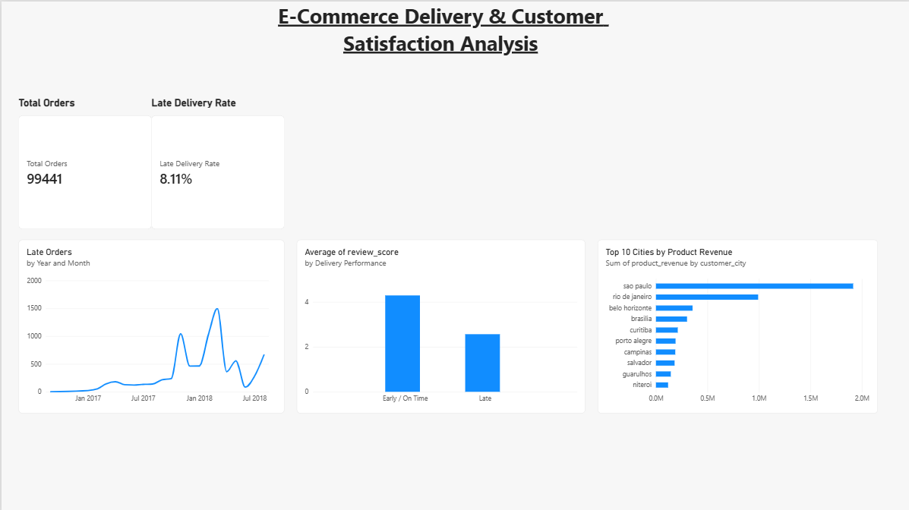

# E-Commerce City & Product Performance Analytics

## Project Overview

This project analyzes the Brazilian E-Commerce Public Dataset by Olist using **MySQL and Power BI**.

The objective is to understand e-commerce performance across cities and product categories, evaluate delivery performance, and investigate how delivery delays relate to customer satisfaction.

The analysis combines SQL-based data exploration with an interactive Power BI dashboard.

## Tools & Technologies

- **MySQL:** Data exploration, SQL queries, aggregations, and analysis
- **Power BI:** Data visualization and dashboard development
- **Git & GitHub:** Version control and project documentation

## Dataset

The project uses the [Brazilian E-Commerce Public Dataset by Olist](https://www.kaggle.com/datasets/olistbr/brazilian-ecommerce).

The dataset contains information about orders, customers, products, sellers, payments, reviews, and delivery dates.

Raw dataset files are excluded from this repository.

## Business Questions

The analysis focuses on the following questions:

1. Which cities generate the highest product revenue?
2. Which product categories contribute most to revenue?
3. How does revenue change over time?
4. What proportion of delivered orders arrive late?
5. Does late delivery relate to lower customer review scores?
6. How does delivery performance vary across customer and seller locations?

## Key Findings

- **99,441 orders** are present in the orders dataset.
- **7,826 orders** were delivered late among 96,470 delivered orders with both actual and estimated delivery timestamps available.
- The late-delivery rate for this eligible group was **8.11%**.
- Late-delivered orders had an average review score of **2.57**, compared with **4.29** for orders delivered early or on time.
- São Paulo generated the highest product revenue among the cities shown in the Top 10 city analysis, followed by Rio de Janeiro.

These findings indicate an association between late delivery and lower customer review scores. They do not, by themselves, establish causation.

## Power BI Dashboard

The dashboard summarizes order volume, delivery performance, customer satisfaction, and city-level product revenue.



### Dashboard Components

- Total Orders KPI
- Late Delivery Rate KPI
- Monthly Late Orders trend
- Average Review Score by Delivery Performance
- Top 10 Cities by Product Revenue

## Repository Structure

```text
ecommerce-city-performance-analysis/
│
├── Dashboard/
│   └── Ecommerce_performance_analysis.pbix
│
├── Data/
│   └── Raw/                 # Excluded from Git
│
├── Docs/
│
├── Reports/
│   └── 01_Ecommerce_performance_analysis.png
│
├── SQL/                     # SQL analysis scripts
│
├── .gitignore
└── README.md
```

## How to Explore the Project

1. Review the SQL scripts in the `SQL/` folder to understand the data analysis.
2. Open `Dashboard/Ecommerce_performance_analysis.pbix` using Power BI Desktop.
3. Review the dashboard visuals and key findings.

The Power BI report may require a local MySQL connection and access to the source dataset to refresh its data.

## Project Outcome

This project demonstrates practical use of SQL for business analysis, data validation, aggregation, and investigation of business problems, followed by visualization of key findings in Power BI.

It documents the workflow from raw e-commerce data to analytical insights and an interactive dashboard.